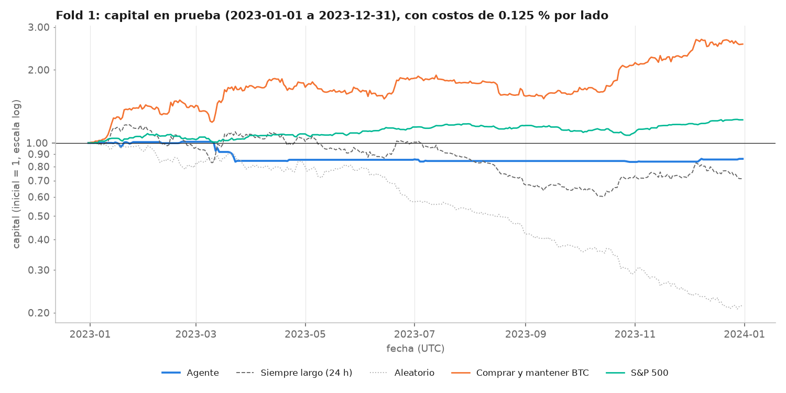
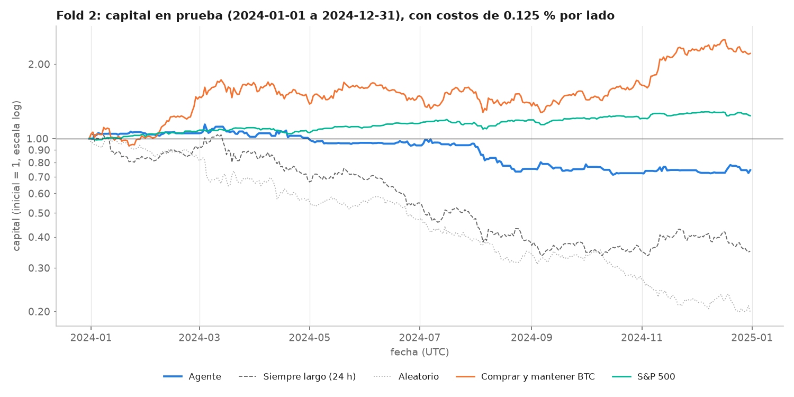
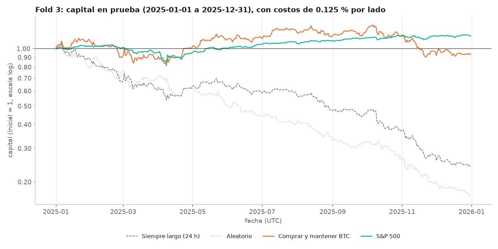
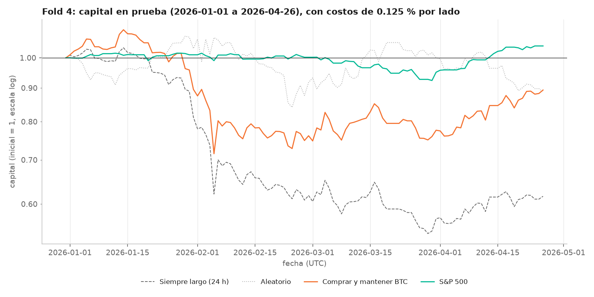
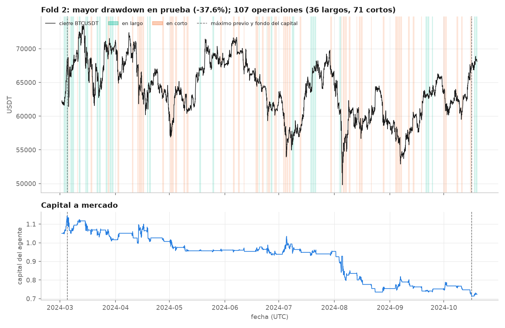

# Agente de reinforcement learning para BTCUSDT horario: entorno semi-Markov y evaluación walk-forward

**Lab04 · Microestructuras y Sistemas de Trading · ITESO** — Equipo 6: Gonzalo Cano y Juan Manuel Espinosa ·
noviembre de 2026

Todas las cifras salen de `artifacts/`, que genera `python main.py` con `SEED = 42`, y de `docs/decisiones.md`. Las
métricas de prueba son de una sola pasada por el conjunto de prueba, con los modelos congelados. La formulación completa
de Powell, con la función que implementa cada elemento, está en el Apéndice A.

## Resumen ejecutivo

- **Problema:** un agente decide, al cierre de cada hora en la que está plano, si esperar o abrir una posición larga o
  corta con todo su capital (sin apalancamiento). La orden se llena a la apertura siguiente y un gestor de posiciones la
  cierra en el stop-loss o el take-profit (a ±1·σ̂·√24 h) o al cumplirse 24 h. Cada lado paga 0.125 %.
- **Modelo:** proceso semi-Markov con épocas de decisión solo estando plano. DQN de Stable-Baselines3 con un replay
  buffer que descuenta cada transición con γ^τ (τ = horas reales de la transición), contribución terminal igual al
  rendimiento log neto de la operación y estado de 25 variables (mercado, creencia y cuenta).
- **Protocolo:** walk-forward de 4 folds con ventana expansiva. Normalizador por fold ajustado solo en entrenamiento,
  16 configuraciones × 3 semillas × 6 puntos de control elegidos en validación por la mediana entre semillas. La
  prueba se tocó una vez.
- **Resultado en prueba (media ± desviación entre folds):** rendimiento total **−15.2 % ± 9.5 %**, Sharpe
  **−0.83 ± 0.34**, drawdown máximo −23.2 % ± 13.7 %. BTC comprar y mantener: +64.7 % y Sharpe 0.94; S&P 500: +17.2 % y
  Sharpe 1.34. El agente **no supera a ningún benchmark ni a no operar**; sí supera al aleatorio (Sharpe −2.92) y a
  siempre largo (−2.02), que pierden por costos.
- **Lectura honesta:** en los folds 2–4 el agente gana algo **en bruto** (+0.07, +0.24 y +0.02 del capital inicial),
  pero rota entre 70 y 380 veces su capital al año y los costos (0.33, 0.43 y 0.05) se llevan esa ganancia. La
  validación ya lo anticipaba: en los folds 2 y 4 ninguno de los 96 candidatos le ganó a no operar. Además, el resultado
  es **frágil**: una latencia que sube el costo 1.5 pb por lado cambia el 22 % de las operaciones del fold 2 y mueve su
  rendimiento 26.6 puntos. Lo que mide el resultado es una señal bruta pequeña e inestable, más chica que el costo de
  operarla.

**Dónde se responde cada pregunta (§4 del enunciado).** P1 y P2: sección 2 · P3: sección 4 · P4 y P5: sección 6 ·
P6: sección 8 · P7: sección 9 · §3.9: sección 7 · §3.10: secciones 8 y 10 · advertencia de interpretación: sección 11.

## 1. Datos, limpieza y variables causales

**Archivo.** `data/Binance_BTCUSDT_1h.csv` (CryptoDataDownload, Binance spot, barras horarias OHLCV en UTC) del
2017-08-17 04:00 al 2026-04-26 23:00. Limpieza (`data.load_ohlcv`, `artifacts/data_report.json`):

| Hallazgo | Cifra | Tratamiento |
|---|---|---|
| Filas leídas | 75,588 (el enunciado dice 75,558) | se usan las **75,082 barras únicas**; la diferencia se explica abajo |
| Marcas en microsegundos | 672 filas (2025-02-12 a 2025-03-11) | se convierten a milisegundos |
| Duplicados | 506 filas que repiten una barra con OHLCV idéntico | se quitan |
| Barras fuera de la hora | 43 | se llevan al inicio de su hora |
| Horas faltantes | 1,114 (687 en 2025 y 300 en 2026); hueco máximo de 145 h | **no se rellenan**; cada barra lleva `gap_hours` |

Ningún conteo natural del archivo da 75,558: hay 75,588 filas, 75,082 marcas únicas y 76,196 horas en el rango. Lo
más probable es que el enunciado venga de otra descarga; se documenta en `data_report.json`.

**Variables (`data.compute_features`).** 22 variables en 6 familias, todas calculadas con barras hasta t inclusive:

| Familia | Variables |
|---|---|
| Rendimientos | ln(P_t/P_{t−k}) con k = 1, 4, 24 y 168 h de reloj |
| Volatilidad | volatilidad realizada en 24 y 168 barras (con r²/Δh para no sesgar tras huecos), Parkinson 24 h, razón 24/168 |
| Tendencia | distancia a las EMA de 24, 168 y 720 h; caída desde el máximo de 720 h |
| Volumen | z-score del volumen en 168 barras; razón de volumen 24/168 |
| Calendario | hora del día y día de la semana en seno y coseno |
| Creencia | deriva EWMA (vida media 168 h), su error estándar y su razón t; volatilidad EWMA en el tiempo (vida media 24 h) |

A estas se suman 3 variables de la cuenta (caída del capital desde su máximo, rendimiento de la última operación y
horas plano) para un vector de 25 componentes.

**Causalidad y normalización.** Los primeros 720 h de datos solo calientan las ventanas (el entrenamiento útil empieza el
2017-09-16 11:00). Cada fold tiene su normalizador z-score ajustado **solo con su entrenamiento** y recortado a ±5
(`data.Normalizer`, `artifacts/normalizer_fold_{k}.csv`); validación y prueba se transforman sin reajustar. La prueba
obligatoria 2 (`tests/test_causality.py`) recalcula las variables con los datos hasta i y obtiene el mismo vector que con
la serie completa, incluso justo después de un hueco.

**Folds (`artifacts/folds.json`).**

| Fold | Entrenamiento | Validación | Prueba | Barras de prueba |
|---|---|---|---|---|
| 1 | 2017-09-16 a 2021-12-31 (37,502 barras) | 2022 | 2023 | 8,759 |
| 2 | a 2022-12-31 (46,262) | 2023 | 2024 | 8,784 |
| 3 | a 2023-12-31 (55,021) | 2024 | 2025 | 8,073 (687 h faltantes) |
| 4 | a 2024-12-31 (63,805) | 2025 | 2026-01-01 a 2026-04-26 | 2,784 |

## 2. Análisis exploratorio, regímenes y estado de información (preguntas 1 y 2)

Todo el análisis usa **solo el train del fold 1** (2017-09 a 2021-12) para no filtrar información a validación ni a
prueba; los trains de los folds 2–4 sirven únicamente para revisar la estabilidad (`notebooks/02_eda.ipynb`,
`artifacts/btcusdt_eda.pdf`).

**Regímenes (pregunta 1).** Se marcan giros de **45 %** en el cierre diario (máximos y mínimos alternos); el umbral es
fijo y reproducible, y con 35 % el bajista de 2018 y la caída de 2019–2020 se partían en rebotes. Salen 8 tramos en el
train del fold 1 (`artifacts/regimes.csv`); el primero y el último son incompletos porque el giro aún no se confirma.

| Tramo | Fechas | Días | Dirección | Rendimiento | Volatilidad anual | Drawdown máx. |
|---|---|---|---|---|---|---|
| 2 | 2017-09-14 a 2017-12-16 | 93 | alza (burbuja de 2017) | +499 % | 97 % | −21 % |
| 3 | 2017-12-16 a 2018-12-15 | 364 | baja (invierno cripto) | −83 % | 87 % | −83 % |
| 4 | 2018-12-15 a 2019-06-26 | 193 | alza (recuperación) | +308 % | 64 % | −16 % |
| 5 | 2019-06-26 a 2020-03-12 | 260 | baja (hasta el choque del COVID) | −63 % | 91 % | −63 % |
| 6 | 2020-03-12 a 2021-04-13 | 397 | alza (ciclo de 2020–21) | +1,224 % | 71 % | −25 % |
| 7 | 2021-04-13 a 2021-07-20 | 98 | baja | −53 % | 92 % | −53 % |

La volatilidad anual va de 64 % a 108 % y cambia con el régimen: las caídas de 2019–20 y 2021 rondan 91–92 % y las alzas
de 2019, 2020–21 y fines de 2021 van de 64 % a 71 %; la excepción es la burbuja de 2017 (97 %). Los giros solo se conocen después de ocurrir, así que **describen el train y nunca entran al estado**; lo
que el agente sí ve es la volatilidad, la tendencia y la caída desde el máximo, calculadas con datos hasta t.

**Propiedades de los rendimientos horarios (train del fold 1, 38,194 barras).** Media 0.01 %, desviación 0.95 %,
asimetría −0.48 y exceso de curtosis 29.8 (Jarque-Bera p ≈ 0): colas muy pesadas. La autocorrelación de los
rendimientos es chica (−0.053 en el rezago 1), mientras que la de los absolutos (0.30) y la de los cuadrados (0.18) es
grande, con Ljung-Box p ≈ 0 a 24 y 168 rezagos: **la volatilidad se agrupa y se predice; la dirección casi no**. El
log-precio no es estacionario (ADF p = 0.83, KPSS p ≤ 0.01), y ADF rechaza la raíz unitaria en las 22 features.

**Estado de información (pregunta 2).** Cada feature se compara con el rendimiento de las 24 h siguientes en una muestra
**sin traslape** (una observación cada 25 h de reloj, n = 1,497 en el fold 1; con todas las horas los objetivos se
traslapan y la información mutua máxima sube artificialmente de 0.056 a 0.183). El nivel de azar es el percentil 95 del
máximo de las 22 IM con objetivos permutados, y el análisis se repite en los 25 desfases de la malla
(`feature_analysis_fold_{k}.csv`, `feature_robustness_fold_{k}.csv`).

| Lo que se encontró | Features | Evidencia (25 desfases, fold 1) |
|---|---|---|
| Informan el **tamaño** del movimiento | `belief_drift_se`, `rv_168h`, `belief_vol`, `rv_24h`, `parkinson_24h`, `drawdown_720h`, día de la semana | IM sobre el azar en 9–21 desfases; p < 0.05 con el valor absoluto del rendimiento en los 25 |
| **Dirección** débil y frágil a la fase | `ret_24h` (ρ = −0.044), `belief_drift_t`, `ema_gap_720h`, `ema_gap_24h` | p < 0.05 en 5–11 de 25 desfases (por azar ≈ 1.2); ninguna en todos |
| Sin evidencia individual | rendimientos de 1, 4 y 168 h, volumen, hora del día, el resto de tendencia | se conservan para la ablación (sección 9) |

Se conservan las 22 features en 6 familias más las 3 de la cuenta: la IM es univariada y no descarta interacciones,
y quedarse solo con las que superan el azar dejaría al agente sin nada sobre tendencia. La **alternativa rechazada** fue
la ventana de precios crudos de la plantilla de clase: el log-precio tiene raíz unitaria, así que la red vería niveles
que no se repiten entre train, validación y prueba. También se rechazaron 24 rezagos del rendimiento, porque su
autocorrelación es casi nula. Hay redundancia entre familias (Spearman de 0.92 a 0.98 entre `rv_24h` y
`parkinson_24h`, `ema_gap_720h` y `belief_drift`, `rv_168h` y `belief_drift_se`), que se declaró antes de la ablación.
**Lectura para lo que sigue:** el estado informa bien cuánto se va a mover el precio y poco hacia dónde; con 0.125 % por
lado, eso anticipa una ventaja direccional chica.

## 3. Formulación como problema de decisión secuencial (resumen)

El detalle, con fórmulas, el ejemplo numérico de una transición completa y la función que implementa cada elemento,
está en el **Apéndice A**. Resumen con la notación de clase:

| Elemento | En este problema |
|---|---|
| Épocas de decisión | cierres t_n de las barras en las que el agente está plano; duración τ_n = t_{n+1} − t_n en horas de reloj (1 h al esperar; de 1 a 24 h, o más con huecos, al operar) |
| Estado físico R | capital E; posición, precio de entrada y tiempo en posición, que solo viven **dentro** de la transición; en la época de decisión entran las 3 variables de la cuenta |
| Estado de información I | 18 variables de mercado (rendimientos, volatilidad, tendencia, volumen, calendario) |
| Estado de creencia B | deriva μ̂ con su incertidumbre se(μ̂) = σ̂/√n_eff y su razón t; volatilidad σ̂ (EWMA en el tiempo) |
| Decisión x | {esperar, abrir largo, abrir corto}; no hay acciones inválidas porque solo se decide plano |
| Información exógena W | la trayectoria de barras OHLCV desde la entrada hasta la salida, con sus huecos |
| Transición S^M | entrada a la apertura siguiente; barreras a ±k·σ̂·√H; gestor: stop, take-profit, horizonte o fin de datos; **stop primero** si una barra toca ambos; contabilidad con 0.125 % por lado |
| Contribución C | rendimiento log neto de la operación al cerrarla (terminal); esperar vale 0 |
| Objetivo | max_π 𝔼[Σ_n γ^{t_n − t_0} C_n] con γ por hora |
| Política | VFA para entrar (DQN: argmax de Q̄) y PFA fija para salir (el gestor) |

**Episodio.** En entrenamiento, ventanas de 720 barras (≈ 30 días) con inicio aleatorio; la ruina (capital < 50 % del
inicial del episodio) es `terminated` y el fin de la ventana es `truncated`. En evaluación, un solo episodio recorre la
partición completa. Se pierde el valor después de 30 días, que solo entra por bootstrap, y la cuenta se reinicia en cada
episodio.

**Pruebas obligatorias (§3.11).** `check_env` sin advertencias en los 4 folds (`tests/test_env_check.py`); causalidad
(`test_causality.py`); operación de referencia calculada a mano con razón de salida, duración y P&L
(`test_reference_trade.py`, que es el ejemplo del Apéndice A); e identidad contable, capital final = inicial + Σ P&L
neto de la bitácora (`test_accounting.py`). En total pasan 94 pruebas.

## 4. Función de contribución (pregunta 3)

**Contribución elegida (`code/reward.py`, `REWARDS["net_log_return"]`).** Al cerrar cada operación se paga su
rendimiento log neto,

C = ln(1 + s·(P_sal − P_ent)/P_ent − c·(P_ent + P_sal)/P_ent),   c = 0.00125 por lado,

y esperar vale 0. Como se opera con todo el capital y sin apalancamiento, **Σ C = ln(capital final)**: el agente optimiza
exactamente el crecimiento que se evalúa, sin coeficientes de moldeo. Se compararon dos alternativas sobre las mismas
operaciones del train del fold 1 (`notebooks/04_contribucion.ipynb`):

- **Log bruto:** le da al aleatorio −0.0002 por operación (casi lo mismo que no operar) y a siempre largo un total de
  +0.53, cuando su capital real cae a 0.6 % del inicial (−5.11 en log) por costos. Premia rotar porque no ve los costos.
- **Log neto normalizado por σ̂·√H:** pone todas las épocas en la misma escala, pero su suma ya no es el capital.

**Terminal contra por paso (pregunta 3).** Se eligió la contribución **terminal**: se paga al cierre y el descuento es
γ^τ con τ en horas de reloj. El agente solo decide estando plano y no actúa durante la operación, así que las
recompensas de las barras intermedias no dependen de ninguna acción que pueda cambiar. Pagada **por paso** (marcando a
mercado en cada barra), la operación suma lo mismo, pero:

1. **Dilución del crédito:** la relación media/desviación de siempre largo baja de −0.063 por operación a −0.015 por
   barra en el train del fold 1. El crédito de abrir se reparte en ≈ 17 recompensas dominadas por el ruido horario.
2. **Sesgo temporal:** el costo de entrada llega como castigo inmediato y, con descuento por barra, la ganancia tardía
   pesa menos que la temprana. El agente aprendería a no abrir o a preferir operaciones que ganen pronto.
3. **Si decidiera en cada barra** (otro diseño de entorno), el pago por paso lo empujaría a cerrar por el ruido del
   marcado a mercado y a **rotar más**, que es justo lo que los costos castigan.

**Las 4 trampas de §3.4.** (1) El P&L bruto premia el riesgo apalancado → log neto y sin apalancamiento. (2) El Sharpe
por episodio no es markoviano → no se usa como recompensa. (3) La suma de logs paga la caída completa pero no su
trayectoria → el estado ve la caída del capital y el drawdown se mide en la evaluación. (4) Coeficientes de moldeo →
ninguno: esperar vale 0 porque γ^τ ya cobra el tiempo plano, y un costo de oportunidad contra BTC empujaría a estar
largo siempre. La formulación completa está en el Apéndice A, sección 6.

## 5. Entrenamiento, búsqueda de hiperparámetros y criterio de selección

> **Pendiente (GC).** Líneas base con costos (`artifacts/baselines.csv`); DQN con `SemiMarkovReplayBuffer`; rejilla de
> 16 configuraciones × 3 semillas con puntos de control cada 50k pasos, solo en validación
> (`validation_results_fold_{k}.csv`); criterio A fijado antes de ver resultados (mediana entre semillas del
> crecimiento log en validación) y semilla mediana a prueba; sobreajuste train contra validación; curvas
> (`training_curves_fold_{k}.png`). Resultado: la misma configuración (tasa 5e-4, γ = 0.99 por hora, red [64, 64],
> exploración 0.1) gana en los 4 folds, con medianas en validación de +0.225, −0.253, +0.005 y −0.063.

## 6. Resultados en prueba (preguntas 4 y 5)

**Por fold.** Rendimiento total en el periodo de prueba; el alfa es el exceso de rendimiento **anualizado** sobre cada
benchmark, que paga el mismo 0.125 % por lado.

| Fold (prueba) | Agente | Sharpe | DD máx. | Operaciones | BTC comprar y mantener | S&P 500 | Alfa vs BTC | Alfa vs S&P 500 |
|---|---|---|---|---|---|---|---|---|
| 1 (2023) | −14.0 % | −1.21 | −17.4 % | 33 | +155.2 % | +24.4 % | −169.2 pp | −38.5 pp |
| 2 (2024) | **−25.4 %** | −1.04 | **−37.4 %** | 142 | +120.9 % | +23.7 % | −145.8 pp | −49.0 pp |
| 3 (2025) | −18.7 % | −0.57 | −30.9 % | 186 | −6.6 % | +16.4 % | −12.1 pp | −35.1 pp |
| 4 (2026, ene–abr) | −2.8 % | −0.52 | −6.9 % | 18 | −10.7 % | +4.2 % | +21.2 pp | −22.5 pp |

**Agregado (media ± desviación entre los 4 folds, `artifacts/metrics_summary.csv`).** Rendimientos y volatilidad
anualizados con capital diario de 365 días y tasa libre de riesgo 0; la rotación es el nocional operado (entrada +
salida) entre el capital medio, por año.

| Métrica | Agente | BTC comprar y mantener | S&P 500 | Siempre plano | Aleatorio | Siempre largo |
|---|---|---|---|---|---|---|
| Rendimiento total | −15.2 % ± 9.5 % | +64.7 % ± 85.8 % | +17.2 % ± 9.4 % | 0 | −63.3 % ± 34.7 % | −52.0 % ± 22.1 % |
| Rendimiento anualizado | −16.7 % ± 7.1 % | +59.8 % ± 91.7 % | +19.6 % ± 5.3 % | 0 | −68.3 % ± 24.7 % | −61.9 % ± 22.9 % |
| Volatilidad anualizada | 20.3 % ± 8.0 % | 48.2 % ± 6.1 % | 14.7 % ± 2.8 % | 0 | 44.2 % ± 7.3 % | 47.1 % ± 7.2 % |
| Sharpe | −0.83 ± 0.34 | 0.94 ± 1.32 | 1.34 ± 0.46 | — | −2.92 ± 1.70 | −2.02 ± 1.08 |
| Sortino | −1.07 ± 0.36 | 1.62 ± 2.22 | 2.01 ± 0.70 | — | −3.57 ± 1.99 | −2.59 ± 1.21 |
| Drawdown máximo | −23.2 % ± 13.7 % | −28.3 % ± 6.7 % | −11.7 % ± 4.9 % | 0 | −66.6 % ± 29.8 % | −60.5 % ± 14.4 % |
| Calmar | −0.83 ± 0.29 | 2.83 ± 4.09 | 1.89 ± 0.86 | — | −1.10 ± 0.22 | −1.04 ± 0.44 |
| Hit rate | 49.4 % ± 1.6 % | 1 operación | 1 operación | — | 45.9 % ± 3.7 % | 47.8 % ± 1.4 % |
| Duración media | 17.9 h ± 1.3 h | todo el periodo | todo el periodo | — | 17.0 h ± 0.4 h | 16.8 h ± 0.8 h |
| Rotación anual | 214× ± 146× | 3.2× ± 2.5× | 3.1× ± 2.2× | 0 | 1,005× ± 28× | 1,046× ± 57× |
| Alfa vs BTC | −76.5 ± 95.0 pp | 0 | −40.2 ± 86.5 pp | −59.8 ± 91.7 pp | −128.1 ± 108.2 pp | −121.7 ± 73.1 pp |
| Alfa vs S&P 500 | −36.3 ± 10.9 pp | +40.2 ± 86.5 pp | 0 | −19.6 ± 5.3 pp | −87.9 ± 28.5 pp | −81.5 ± 18.9 pp |

*Figura 1. Capital en prueba del agente contra BTC comprar y mantener, S&P 500, siempre largo y aleatorio, folds 1 a 4
(`equity_curves_test_fold_{k}.png`).*

**Pregunta 4: ¿cómo varía el desempeño entre folds y qué explica el más débil?** El agente pierde en los cuatro folds.
La pérdida crece con el número de operaciones: los folds 1 y 4 operan poco (33 y 18 operaciones, 7 % y 11 % del tiempo
en el mercado) y pierden 14.0 % y 2.8 %; los folds 2 y 3 operan 142 y 186 veces (28 % y 38 % del tiempo) y pierden
25.4 % y 18.7 %. La descomposición de la bitácora, en unidades del capital inicial, muestra que en los folds 2–4 el agente
gana en bruto y pierde por costos:

| Fold | P&L bruto | Costos | P&L neto | Cortos / largos |
|---|---|---|---|---|
| 1 | −0.063 | 0.077 | −0.140 | 13 / 20 |
| 2 | +0.071 | 0.326 | −0.254 | 88 / 54 |
| 3 | +0.240 | 0.427 | −0.187 | 172 / 14 |
| 4 | +0.017 | 0.045 | −0.028 | 11 / 7 |

El **fold más débil es el 2 (2024)**: el mayor rendimiento negativo (−25.4 %) y el mayor drawdown (−37.4 %). Lo
explican tres cosas:

1. **La validación ya lo advertía.** En el fold 2 ninguno de los 96 candidatos (configuración × pasos) tuvo mediana
   positiva en validación (2023); el elegido tenía −0.253 de crecimiento log. El protocolo manda a prueba el mejor
   candidato aunque pierda contra no operar, y así se reporta.
2. **Rotación con costos.** Con 142 operaciones paga 0.326 del capital en costos contra +0.071 de ganancia bruta.
3. **Dirección contra la tendencia.** El 62 % de sus operaciones son cortos en un año en que BTC sube 120.9 %. Sus
   cortos ganan en bruto (+0.078), pero pierden 0.121 netos; los largos pierden en ambos casos.

Su peor tramo (sección 7.2) es un mercado lateral de 7 meses en el que BTC terminó donde empezó.

**Pregunta 5: ¿supera a comprar y mantener BTC y al S&P 500 después de costos?** **No.** Su Sharpe medio es −0.83,
contra 0.94 de BTC y 1.34 del S&P 500, y su alfa medio es −76.5 pp contra BTC y −36.3 pp contra el S&P 500. Solo en el
fold 4 pierde menos que BTC (−2.8 % contra −10.7 %, drawdown −6.9 % contra −35.2 %), porque casi no opera y BTC cae;
en el fold 3 pierde más que BTC aunque este también cae. Tampoco supera a **no operar** en ningún fold.

Entonces, ¿qué mide el resultado? Mide una **señal bruta pequeña que no sobrevive a los costos**: el agente aprende algo
en bruto, sobre todo en cortos (folds 2–4), pero esa ventaja es menor que el 0.25 % que cuesta cada vuelta. No es una
exposición disfrazada a BTC: su volatilidad es 20 %, menos de la mitad de la de BTC, y su correlación diaria con BTC es
casi nula salvo en 2025 (sección 7.3). Superar al aleatorio y a siempre largo solo indica que opera menos que ellos, no
que tenga ventaja.

## 7. Análisis de operaciones (§3.9)

### 7.1 Las tres operaciones con mayor pérdida (todos los folds de prueba)

Valores del estado **sin normalizar**, en la barra de decisión (`artifacts/trade_analysis.json`). La pérdida es el
rendimiento neto sobre el capital antes de la operación; las barreras están a ±σ̂·√24.

| | 1 | 2 | 3 |
|---|---|---|---|
| Fold y lado | 2 · corto | 3 · corto | 1 · largo |
| Decisión → entrada (UTC) | 2024-08-05 13:00 → 14:00 | 2025-03-07 00:00 → 01:00 | 2023-03-14 12:00 → 13:00 |
| Precio de entrada | 51,951.01 | 85,529.23 | 25,832.57 |
| Salida (UTC), precio y razón | 2024-08-05 16:00 · 55,588.42 · **stop** | 2025-03-07 14:00 · 90,557.77 · **stop** | 2023-03-14 19:00 · 24,342.18 · **stop** |
| Duración | 3 h | 14 h | 7 h |
| Pérdida neta | **−7.26 %** | **−6.14 %** | **−6.01 %** |
| σ̂ por hora → distancia del stop | 1.43 % → 7.0 % | 1.20 % → 5.9 % | 1.18 % → 5.8 % |
| Rendimiento 1 h / 24 h / 168 h | +4.2 % / −15.8 % / −28.8 % | −5.0 % / −5.1 % / +1.5 % | +4.3 % / +15.5 % / +14.3 % |
| Volatilidad 24 h / 168 h (razón) | 2.08 | 1.17 | 1.66 |
| Volumen (z en 168 barras) | 2.50 | 2.39 | 2.99 |
| Caída desde el máximo de 720 h | −25.6 % | −14.2 % | 0 % (en máximo) |
| Razón t de la deriva | −2.37 | −0.65 | +1.81 |

**Contexto e interpretación.**

1. **Fold 2, 5 de agosto de 2024.** Coincide con la venta global de ese día: BTC había caído 15.8 % en 24 h. El agente
   vende en corto después del desplome, con la tendencia, la deriva (t = −2.37) y la caída de 30 días apuntando abajo.
   El precio rebota 7 % en tres horas y toca el stop.
2. **Fold 3, 7 de marzo de 2025.** Coincide con la noticia de la reserva estratégica de bitcoin de EE. UU.: una caída de
   5 % en una sola hora. El agente reacciona al rendimiento de 1 h (la deriva no es significativa, t = −0.65) y el
   precio se recupera en el día.
3. **Fold 1, 14 de marzo de 2023.** Coincide con el rebote tras la intervención por la quiebra de Silicon Valley Bank:
   +15.5 % en 24 h y precio en máximo de 30 días. El agente compra la continuación y el precio retrocede al stop en
   7 horas.

**Modo de falla común.** Las tres son apuestas a la **continuación justo después de un choque extremo**: |rendimiento de
24 h| entre 5 % y 16 %, volumen 2.4–3.0 desviaciones arriba de lo normal y σ̂ ≈ 3 veces la mediana del año de prueba
(0.38–0.50 % por hora). El precio revierte y toca el stop. Como la posición es siempre el 100 % del capital y
el stop está a σ̂·√24, la pérdida en el stop crece con σ̂: **las peores operaciones son justo las de mayor volatilidad**.

**Qué tendría que cambiar.**

- **Gestión de riesgo:** dimensionar la posición contra σ̂ (riesgo fijo al stop, p. ej. 2 % del capital). Estas tres
  operaciones habrían perdido ≈ 2 % en lugar de 6–7 %. Otra opción es no abrir cuando la razón de volatilidad 24/168 es
  mayor que 2.
- **Representación del estado:** agregar el tamaño del movimiento relativo a σ̂ (|ret_24h|/(σ̂·√24)) y las horas desde
  el último choque. Las familias actuales miden el nivel de la volatilidad, no si acaba de ocurrir un choque, que es
  cuando la reversión es más probable.
- **Recompensa:** el log neto ya castiga más las pérdidas que las ganancias, pero poco a la escala de 7 %. Un castigo por
  cola (CVaR o por salir en stop) lo haría más visible, a costa de un coeficiente de moldeo más que habría que ajustar en
  validación, algo que se descartó en la parte 04.

### 7.2 El periodo del mayor drawdown (fold 2)

El mayor drawdown de prueba ocurre en el fold 2: del **5 de marzo** al **16 de octubre de 2024**, −37.6 % sobre el capital
horario (−37.4 % sobre el diario), sin recuperarse antes de fin de año (`max_drawdown_fold_2.png`). Empieza el día del
máximo histórico de BTC de marzo y abarca siete meses laterales: BTC cerró en 68,506 al inicio y en 67,895 al final
(−0.9 %), con un rango amplio de por medio.

Entre el máximo y el fondo, el agente tiene **101 operaciones** (71 cortos y 30 largos) y está en el mercado el 31 % del
tiempo; la figura agrega 3 días antes y después, por eso su título cuenta 107. Pierde 0.190 del capital inicial en
bruto y paga 0.237 en costos: los costos son el 55 % de la pérdida. Entra después de movimientos que no continúan
(falsas rupturas) y paga 0.25 % en cada vuelta. Es el mismo modo de falla de la sección 7.1, repetido en un mercado
sin tendencia.

En los otros folds el mayor drawdown es −19.8 % (fold 1), −33.1 % (fold 3) y −12.0 % (fold 4), sobre capital horario
(`max_drawdown_fold_{k}.png`).

### 7.3 Correlación con BTC

Correlación y beta de los rendimientos diarios del agente contra los de BTC en prueba:

| Fold | Correlación | Beta | Días |
|---|---|---|---|
| 1 | −0.02 | −0.01 | 365 |
| 2 | −0.10 | −0.05 | 366 |
| 3 | −0.49 | −0.34 | 365 |
| 4 | +0.23 | +0.07 | 116 |

**El agente no es un largo apalancado ni filtrado:** la correlación es casi nula en los folds 1 y 2, y la beta nunca
pasa de 0.07 en valor absoluto salvo en el fold 3. En el fold 3 (2025) se comporta como un **corto filtrado**: 172 de
sus 186 operaciones son cortos y su beta es −0.34. Por eso, en un año en que BTC cae 6.6 %, sus cortos ganan +0.164 en
bruto, pero los costos de 186 operaciones dejan el neto en −18.7 %.

## 8. Sensibilidad a los supuestos del simulador (pregunta 6 y §3.10)

Cada escenario cambia **un solo** supuesto del entorno, con el mismo modelo congelado y la misma prueba
(`evaluate.run_sensitivity`, `artifacts/sensitivity.csv`, notebook 07). Para separar el efecto directo de un supuesto
del de decisiones distintas, se mide qué proporción de las operaciones de la base repite el escenario (misma hora de
decisión y mismo lado).

| Escenario | Δ rendimiento total, folds 1 / 2 / 3 / 4 | Media ± desv. | Δ Sharpe medio | Operaciones repetidas |
|---|---|---|---|---|
| Take-profit primero (§3.3) | 0 / 0 / 0 / 0 | 0 | 0 | 100 % |
| Una barra de retraso en los datos | −2.7 / +2.2 / −9.5 / −13.0 pp | −5.7 ± 6.8 pp | −0.53 | 6–14 % |
| Latencia de 2 s (+1.35 a +1.56 pb por lado) | −0.9 / **+26.6** / +0.7 / −0.5 pp | +6.5 ± 13.4 pp | +0.27 | 78–100 % |
| +5 pb por lado | −2.8 / −5.5 / −9.6 / −1.7 pp | −4.9 ± 3.5 pp | −0.33 | 75–100 % |
| +10 pb por lado | −5.5 / −19.4 / −18.2 / −3.4 pp | −11.6 ± 8.3 pp | −0.81 | 70–100 % |
| +25 pb por lado | −16.7 / −41.0 / −39.2 / −8.4 pp | −26.3 ± 16.3 pp | −2.10 | 52–100 % |

**Pregunta 6.**

- **Resolución intrabarra:** ninguna de las 379 operaciones del agente toca el stop y el take-profit en la misma barra,
  así que suponer lo contrario (take-profit primero) no cambia nada. En todo el artefacto, incluidas las líneas base,
  hay una sola operación ambigua. Con barreras a ±σ̂·√24 (5–7 % en las peores operaciones, ≈ 2–2.5 % en una hora
  típica), una barra horaria rara vez cubre ambas. El resultado **no depende** de ese supuesto.
- **Una barra de retraso:** cuesta en promedio 5.7 pp y 0.53 de Sharpe, pero lo más importante es que el agente repite
  solo entre el 6 % y el 14 % de sus operaciones. Sus decisiones dependen de la última barra (el rendimiento de 1 h
  aparece en las tres peores operaciones), así que con datos retrasados es otra estrategia.

**La fragilidad del fold 2.** La latencia sube el costo de 0.125 % a 0.140 % por lado. Si el agente repitiera sus 142
operaciones, el efecto directo sería de ≈ −1.5 pb × 2 lados × 142 ≈ −4 pp. En cambio, repite el 78 % y su rendimiento
**sube** de −25.4 % a +1.2 %. La razón: el estado incluye la cuenta (caída desde el máximo, última operación, horas
plano), así que un capital apenas distinto lleva a otras decisiones que se encadenan. No es que pagar más ayude; es que
**perturbaciones del orden de 1 pb mueven el resultado de prueba más que la diferencia entre el agente y no operar**. El
resultado de prueba de un solo modelo tiene una incertidumbre mucho mayor de lo que sugieren sus cifras puntuales, lo
mismo que mostró la dispersión entre semillas en validación (en el fold 3, +0.037, +0.005 y −0.998).

## 9. Ablación por familias y segundo algoritmo (pregunta 7)

> **Pendiente (GC).** Ablación: reentrenar con la configuración elegida y varias semillas quitando cada familia de
> variables (`artifacts/ablation.csv`), reportada sin reelegir el modelo con la prueba. Segundo algoritmo (PPO) con la
> misma búsqueda en validación (`artifacts/algorithm_comparison.csv`).

## 10. Fallas de producción (§3.10)

**Supuestos de ejecución.** El simulador llena la entrada a la **apertura de la barra siguiente** y las salidas
**exactamente en el nivel** del stop o del take-profit (o a la apertura si el precio salta el nivel), con 0.125 % por
lado y sin spread, impacto ni llenados parciales. En Binance la apertura de t + 1 coincide con el cierre de t (mediana
de |apertura/cierre previo| ≈ 0), así que el precio supuesto es el de la decisión. En la realidad, un stop es una orden
de mercado que se ejecuta **cuando el precio se mueve rápido**, que es justo cuando el libro está más delgado. Las tres
peores operaciones son de ese tipo, así que su deslizamiento real sería mayor que el promedio. No hay datos de libro de
órdenes (y no se permiten datos externos), así que el efecto se mide con una rejilla de costo extra: **+5, +10 y +25 pb
por lado le quitan 4.9, 11.6 y 26.3 pp de rendimiento anual al agente**, y 15.8, 25.6 y 38.8 pp a siempre largo, que
rota ≈ 1,000 veces su capital. Tampoco se cobra el préstamo para vender en corto en spot: el agente está en corto el 17 % y
el 35 % del año en los folds 2 y 3, así que con una tasa ilustrativa de 5 % anual sobre lo prestado serían ≈ 0.9 y
1.8 pp más.

**Latencia.** Si inferir toma 2 s, el llenado pierde el movimiento de esos 2 s. Con rendimientos sin deriva a esa
escala, su tamaño típico es σ̂·√(2/3600): 1.35–1.56 pb por lado con la σ̂ mediana del train de cada fold. Es pequeño
frente al 0.125 % (≈ 11–12 % del costo), así que el precio supuesto **sigue disponible** salvo en movimientos extremos.
En los folds 1, 3 y 4 cambia el resultado entre −0.9 y +0.7 pp; en el fold 2 cambia las decisiones (sección 8). **Un
retraso de una barra** en los datos sí cambia la estrategia: se repite solo el 6–14 % de las operaciones y se pierden
5.7 pp en promedio.

**Capacidad y saturación.** En 2023–2026, el volumen mediano por hora de BTCUSDT en Binance spot es de 46 a 65 millones
de USDT. El agente opera con órdenes de mercado a la apertura de la hora, justo después de movimientos fuertes. Si 50
fondos con la misma señal pusieran 10 millones cada uno, la orden conjunta (500 millones) sería 8–11 veces el volumen
de una hora típica. Con una regla de impacto de raíz cuadrada (orden de magnitud, no calibrada), el impacto sería del
orden de σ̂_hora·√10 ≈ 1.3–1.6 % por lado, más de diez veces el costo supuesto. Ya con +5 pb el agente pierde 4.9 pp
más, y su ventaja neta ya es negativa: **no hay nada que repartir entre 50 fondos**.

¿Quién está del otro lado? Como el agente consume liquidez después de choques, del otro lado están los creadores de
mercado, que cobran el spread y ajustan sus cotizaciones tras el choque, y los participantes que apuestan a la reversión
o que operan con información (las noticias de la sección 7.1). Operan con el agente porque se les paga por dar liquidez
o porque saben algo que él no ve. Con esa selección adversa, las salidas en stop de la sección 7.1 serían peores en la
realidad, no mejores.

**Cambio de régimen.** Las pruebas cubren 2023, 2024, 2025 y 2026 hasta abril, con cambios del precio de BTC de
+155.6 %, +121.3 %, −6.3 % y −10.4 %.
Los años de prueba fueron **menos volátiles que el entrenamiento**: en todos los folds la volatilidad de prueba queda
0.35–0.80 desviaciones del train por debajo de su media.

- **Un año como 2018 (−73 %) o 2022 (−64 %)** no es nuevo: ambos están en el entrenamiento de los folds 2–4, y 2022 es
  la validación del fold 1, donde el candidato elegido tuvo su mejor mediana (+0.225). Como las ganancias brutas del
  agente vienen sobre todo de los cortos, un año bajista probablemente lo ayudaría en bruto, pero no cambia que la
  rotación cueste más de lo que gana (en 2025, con BTC a la baja, los cortos ganan +0.164 en bruto y el fold pierde
  18.7 %). En 2018 el volumen por hora era de ≈ 9 millones de USDT, así que el impacto también sería mayor.
- **Un régimen ausente del entrenamiento** (volatilidad muy baja de forma persistente, o choques más grandes que los de
  2017–2024) degradaría primero las variables cuya escala depende del régimen: **volatilidad y creencia** (σ̂, volatilidad
  realizada, Parkinson), que se normalizan con la media y la desviación del train y son además las únicas con
  información mutua por encima del azar en la parte 02 (salvo la caída de 720 h en el fold 3), y las de **tendencia de largo plazo** (EMA de 720 h y caída de
  720 h), que cambian de signo solo con el ciclo. Las de rendimiento de corto plazo y de volumen relativo se normalizan
  contra su propia ventana y se degradarían menos. El gestor sí se adapta, porque sus barreras escalan con σ̂.

## 11. Advertencia de interpretación y limitaciones

**Advertencia.** El simulador modela la política y supone que el resto del sistema es **gratuito, instantáneo y
perfecto**: llena a la apertura sin spread ni impacto, sale en el nivel exacto de la barrera, infiere al instante, recibe
cada barra sin retraso y no paga el préstamo de los cortos. Con los experimentos de la sección 8, esa distancia vale:

| Supuesto relajado | Efecto medio en el rendimiento anual del agente |
|---|---|
| Ejecución con 5 / 10 / 25 pb más por lado | −4.9 / −11.6 / −26.3 pp |
| Latencia de 2 s | −0.5 a −0.9 pp cuando las decisiones no cambian; ±27 pp cuando sí (fold 2) |
| Una barra de retraso | −5.7 ± 6.8 pp, con otras decisiones en el 86–94 % de las operaciones |
| Resolución intrabarra contraria | 0 (ninguna operación ambigua) |
| Préstamo de los cortos (5 % anual, ilustrativo) | ≈ −0.9 y −1.8 pp en los folds 2 y 3 |

Como el agente ya pierde con los supuestos perfectos, relajarlos lo empeora: **la conclusión no cambia**.

**Limitaciones.**

- **Un solo año de validación por fold** para elegir entre 96 candidatos. El mejor está sesgado hacia arriba (maldición
  del ganador) y en dos folds ni el mejor le ganó a no operar.
- **Inestabilidad:** la dispersión entre semillas y la fragilidad ante perturbaciones de 1 pb indican que la cifra de
  prueba de un solo modelo es poco precisa. Un ensamble de semillas o más años de validación darían una estimación más
  estable.
- **Tamaño fijo:** cada operación compromete el 100 % del capital, así que la pérdida en el stop crece con la volatilidad
  (sección 7.1).
- **Horas faltantes:** la prueba del fold 3 tiene 687 h sin datos (2025). El gestor sale a la apertura posterior al
  hueco, pero un sistema real habría tenido precio en esas horas.
- **Episodios de 30 días:** el valor más allá de 720 barras solo entra por bootstrap y la cuenta se reinicia en cada
  episodio, mientras que la evaluación recorre el año completo.

## Apéndice A. Formulación completa como problema de decisión secuencial

<!-- generar_pdf.py inserta aquí docs/powell.md -->
